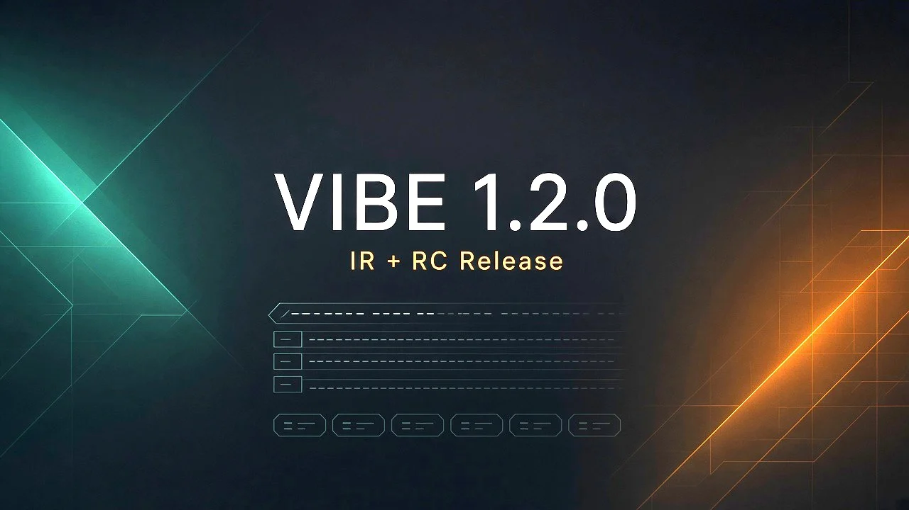
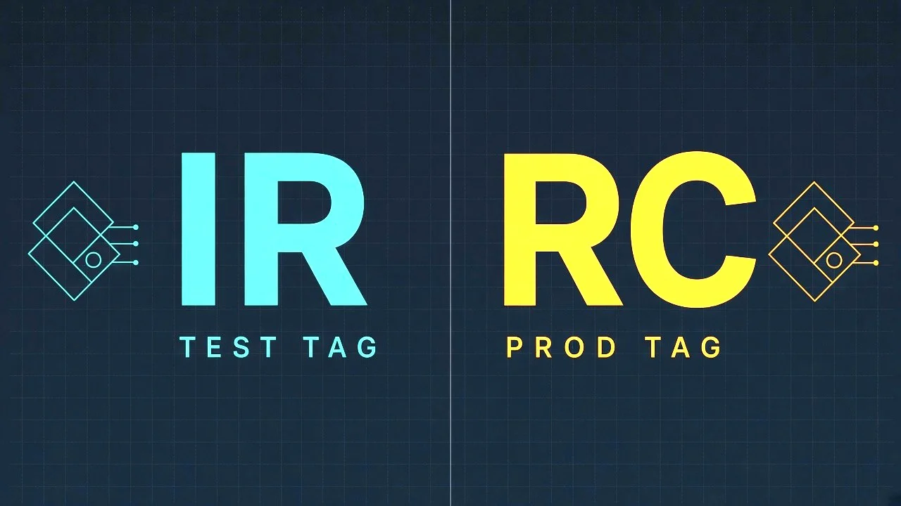
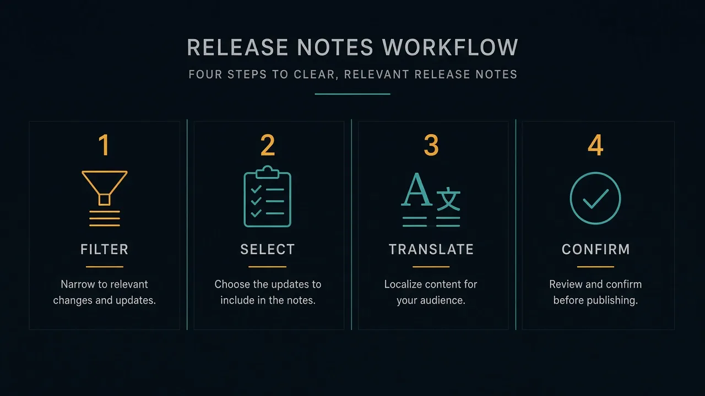
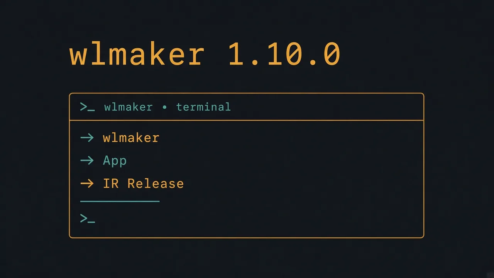

# Lanzamiento — VIBE 1.2.0 + wlmaker 1.10.0



El equipo de **Blondon Boys** anuncia **VIBE v1.2.0** y **wlmaker-cli v1.10.0**.

Novedad principal: **IR Release** y **RC Release** — bump, notas filtrables y tags **sin abrir vim**.

---

## Dos flujos



| Flujo | Qué hace |
| --- | --- |
| **IR Release** | Bump de versión de test, filtra PRs, arma notas, crea el tag |
| **RC Release** | Tag de prod con notas filtradas (store opcional) |

Disponible en **cumbia**, **Studio** (vía App) y el **CLI**.

---

## Editor de notas



1. **Filtrar** por tags de los tickets/PRs  
2. **Seleccionar** qué entra en las notes  
3. **Traducir** títulos con MyMemory — **pt / en / es**  
4. **Confirmar** → el flujo continúa en la terminal / wizard (sin vim)

Formato: `WR-xxxx → título`.

---

## wlmaker-cli v1.10.0



```bash
pnpm add -g wlmaker@latest
wlmaker
# → App → IR Release | RC Release
```

---

## Instalación VIBE

```text
https://github.com/MatiasZL/vibe-dist/releases/latest/download/vibe.vsix
```

```bash
chmod +x install-vibe.command
./install-vibe.command
```

**Un maker. Dos puertas. Ahora también releases sin vim.**

Saludos,  
**Blondon Boys**
