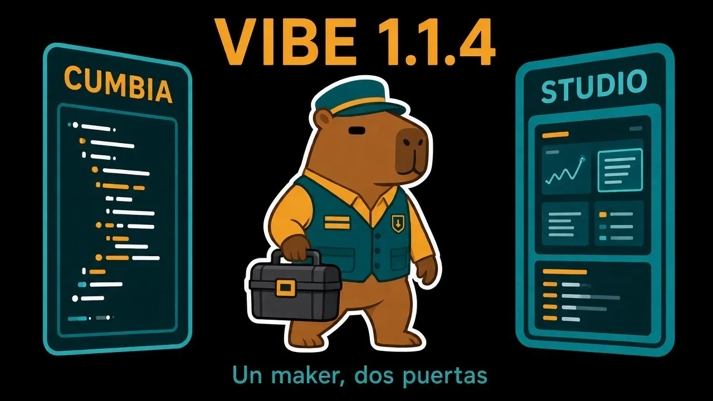
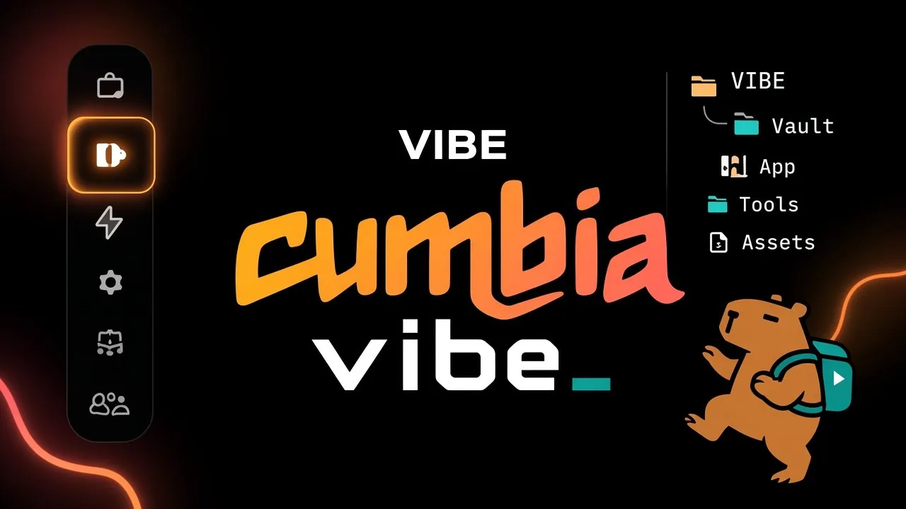

# 🚀 Lanzamiento — VIBE 1.2.0 + wlmaker 1.10.0



El equipo de **Blondon Boys** anuncia **VIBE v1.2.0** y **wlmaker-cli v1.10.0**.

Novedad principal: **IR Release** y **RC Release** — bump, notas filtrables y tags **sin abrir vim**.

---

## 🏷️ IR + RC Release

Disponible en **cumbia**, **Studio** (vía App) y el **CLI**:

| Flujo | Qué hace |
| --- | --- |
| **IR Release** | Bump de versión de test, filtra PRs, arma notas, taggea |
| **RC Release** | Tag de prod con notas filtradas (store opcional) |

### Editor de notas (navegador / webview)

1. **Filtro por tags** de los tickets/PRs  
2. **Selección** de qué entra en las notes  
3. **Traducir** títulos con MyMemory — idioma **pt / en / es**  
4. **Confirmar** → el flujo sigue en la terminal / wizard (sin vim)

Formato de notes: `WR-xxxx → título`.

> Misma lógica en CLI y VIBE. Paridad observable.

---

## 🕺 Dónde está



• **cumbia / CLI** → App → **IR Release** / **RC Release**  
• Viewer local: CLI abre HTTP; VIBE usa WebviewPanel  

---

## 📦 Instalación VIBE

```text
https://github.com/MatiasZL/vibe-dist/releases/latest/download/vibe.vsix
```

```bash
chmod +x install-vibe.command
./install-vibe.command
```

## 🖥️ wlmaker-cli v1.10.0

```bash
pnpm add -g wlmaker@latest
wlmaker
# → App → IR Release | RC Release
```

---

**Un maker. Dos puertas. Ahora también releases sin vim.**

Saludos,  
**BlondonBoys**
